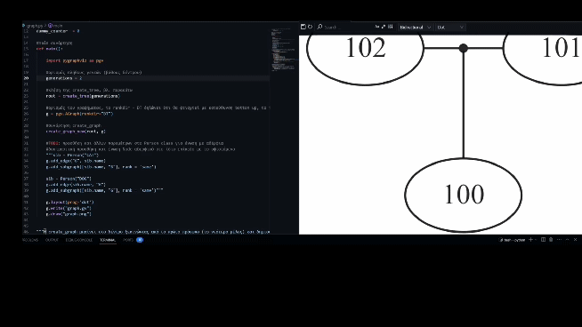
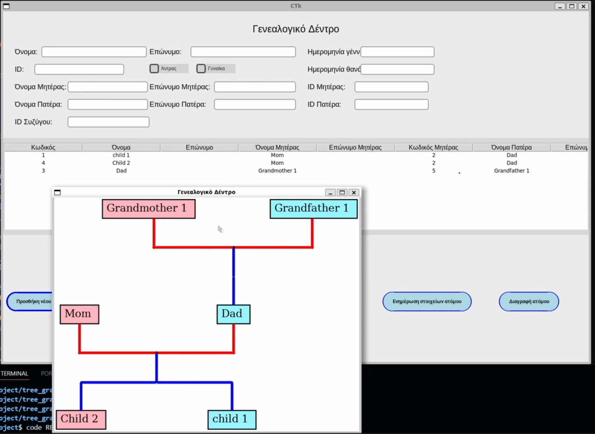
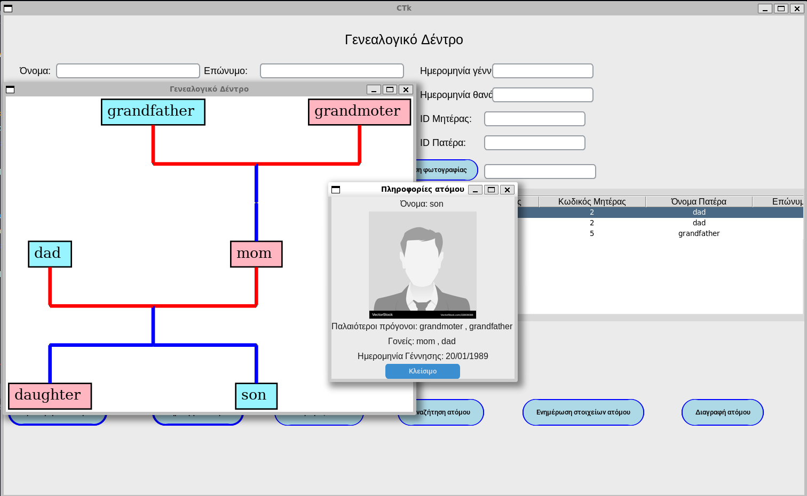

# Αποθετήριο για το προγραμματιστικό πρότζεκτ της ΠΛΗΠΡΟ

- *update 20/3/2024* : Πρώτη υλοποίηση (binary tree) -> **tree.py**
- *update 23/3/2024* : **tree.py**-> Migrate κώδικα σε pygraphviz, βελτίωση υλοποίησης απεικόνισης για σωστή εμφάνιση σε κάθε επίπεδο generations. Αλλαγή της μεταβλητής **generations** διαμορφώνει ανάλογα το δέντρο.

    ### Παράδειγμα: Διαδοχικές τιμές generations: 2, 3, 4, 5
    
    

- *update 6/4/2024* : **tree.py**-> Επέκταση του Person class, εύρεση πλήθους γενεών και επιπέδων δέντρου αναδρομικά, αυτοματοποίηση σχεδίασης ανα από το pygraphviz

    ### Απεικόνιση default μικρού δέντρου

    

     ### Απεικόνιση μεγάλου δέντρου

     

- *update 11/4/2024* : **tree.py**-> Βελτίωση αναδρομής περιορίζοντας κάποιες περιττές κλήσεις, **νεο feature:** ανάκτηση γενεαλογικών δεδομένων από αρχείο json, βλ. φάκελο data -> *προσωρινά ανενεργό*

- *update 21/4/2024* : **Tree.py & Gui.py**-> Οργάνωση του κώδικα λογικής και σχεδιασμού από το tree.py και του gui από το tkinter σε νέα αρχεία με αντικειμενοστραφή προσέγγιση για καλύτερη διαχείριση. Τα 2 modules επικοινωνούν τώρα μεταξύ τους και έχουμε μία πρώτη λειτουργική έκδοση του προγράμματος

    ### Απεικόνιση μετά από είσοδο του χρήστη

    

- *update 1/5/2024* : Προσθήκη δυνατότητας διαγραφής ατόμου από το δέντρο (Κουμπί Διαγραφή Ατόμου)

- *update 2/5/2024* : Νέα δυνατότητα: file saving (json και png σε φακέλους data και graph αντίστοιχα)

- *update 3/5/2024* : Νέα δυνατότητα: επιλογή υπάρχοντος ατόμου από το treeview εμφανίζει τα στοιχεία του στις φόρμες για γρήγορη προσθήκη αδερφιών

- *update 6/5/2024* : Αλλαγή κέρσορα σε χεράκι όταν περνάει πάνω από κόμβο ατόμου + εμφάνιση popup λεπτομερειών όταν γίνει κλικ

- *update 8/5/2024* : Δυνατότητα προσθήκης φωτογραφίας (εμφάνιση και στο popup λεπτομερειών)

