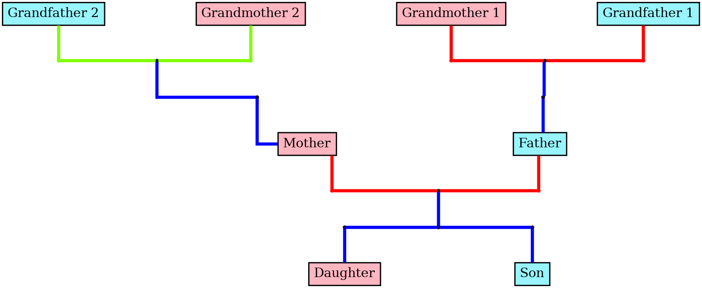
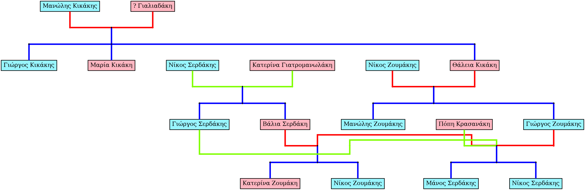

# Αποθετήριο για το προγραμματιστικό πρότζεκτ της ΠΛΗΠΡΟ

- *update 20/3/2024* : Πρώτη υλοποίηση (binary tree) -> **tree.py**
- *update 23/3/2024* : **tree.py**-> Migrate κώδικα σε pygraphviz, βελτίωση υλοποίησης απεικόνισης για σωστή εμφάνιση σε κάθε επίπεδο generations. Αλλαγή της μεταβλητής **generations** διαμορφώνει ανάλογα το δέντρο.

    ### Παράδειγμα: Διαδοχικές τιμές generations: 2, 3, 4, 5
    
    

- *update 6/4/2024* : **tree.py**-> Επέκταση του Person class, εύρεση πλήθους γενεών και επιπέδων δέντρου αναδρομικά, αυτοματοποίηση σχεδίασης ανα από το pygraphviz

    ### Απεικόνιση default μικρού δέντρου

    

     ### Απεικόνιση μεγάλου δέντρου

     

- *update 11/4/2024* : **tree.py**-> Βελτίωση αναδρομής περιορίζοντας κάποιες περιττές κλήσεις, **νεο feature:** ανάκτηση γενεαλογικών δεδομένων από αρχείο json, βλ. φάκελο data.